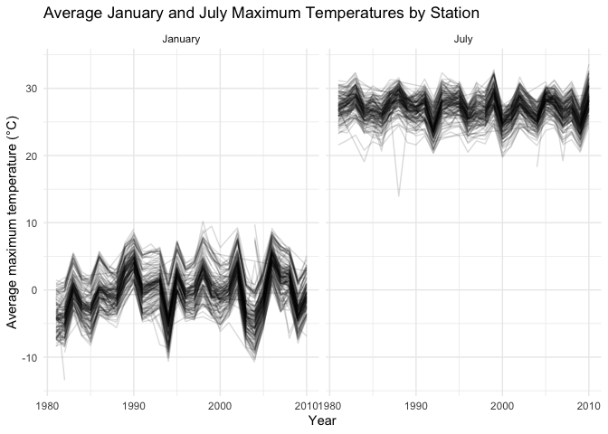
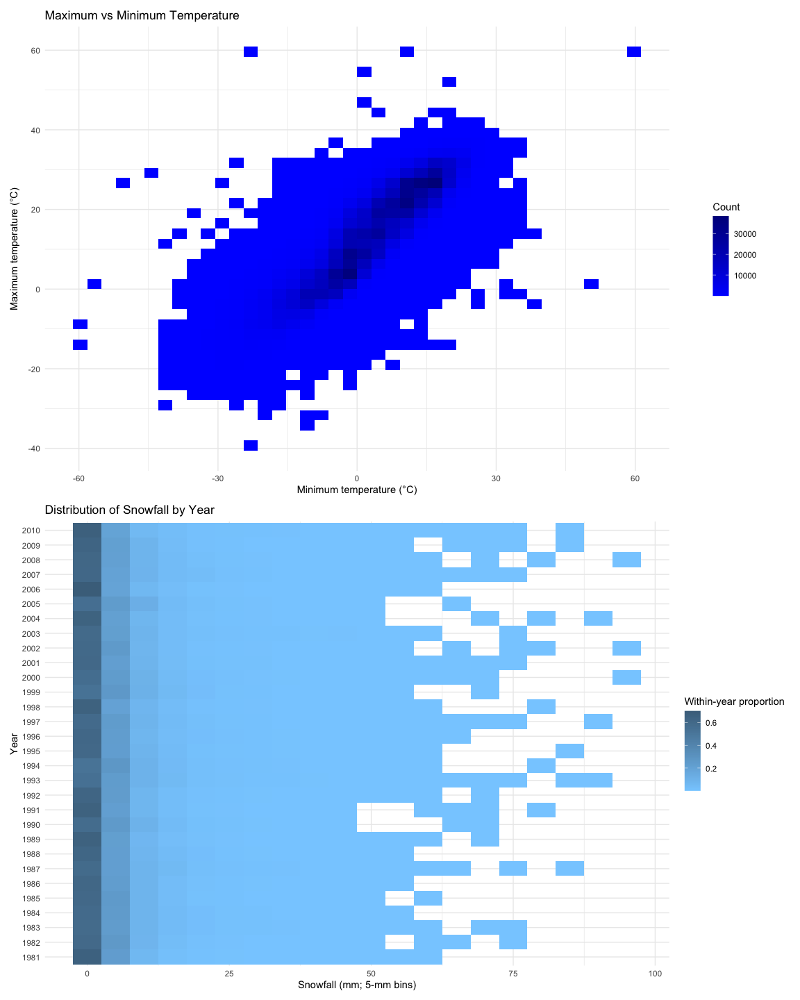
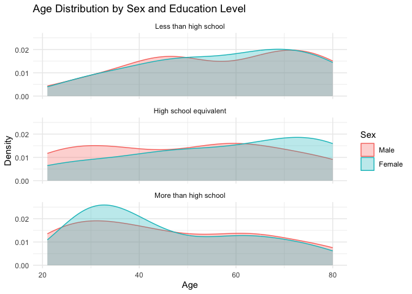
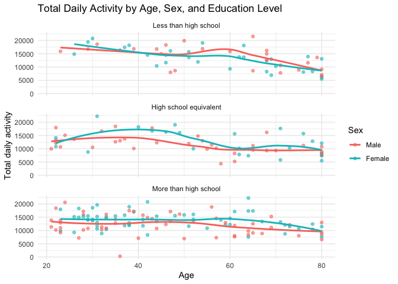
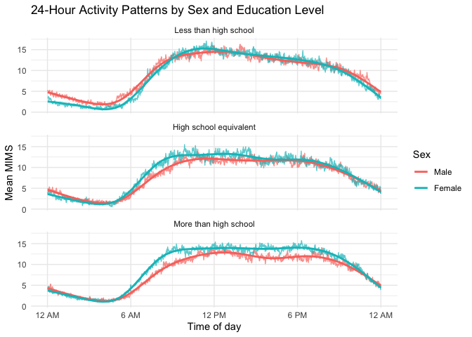
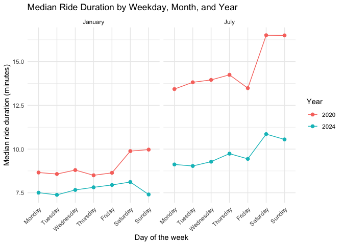
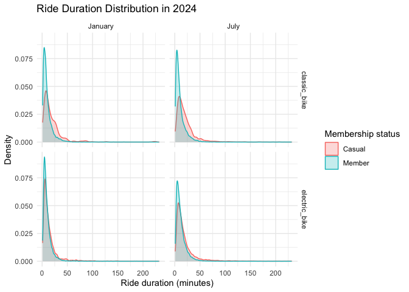

p8105_hw3_zg2627
================
Zimu Guan
2026-10-19

## Problem 1

``` r
library(tidyverse)
```

    ## ── Attaching core tidyverse packages ──────────────────────── tidyverse 2.0.0 ──
    ## ✔ dplyr     1.2.1     ✔ readr     2.2.0
    ## ✔ forcats   1.0.1     ✔ stringr   1.6.0
    ## ✔ ggplot2   4.0.3     ✔ tibble    3.3.1
    ## ✔ lubridate 1.9.5     ✔ tidyr     1.3.2
    ## ✔ purrr     1.2.2     
    ## ── Conflicts ────────────────────────────────────────── tidyverse_conflicts() ──
    ## ✖ dplyr::filter() masks stats::filter()
    ## ✖ dplyr::lag()    masks stats::lag()
    ## ℹ Use the conflicted package (<http://conflicted.r-lib.org/>) to force all conflicts to become errors

``` r
library(p8105.datasets)

data("ny_noaa")

# Check data shape and structure
dim(ny_noaa)
```

    ## [1] 2595176       7

``` r
glimpse(ny_noaa)
```

    ## Rows: 2,595,176
    ## Columns: 7
    ## $ id   <chr> "US1NYAB0001", "US1NYAB0001", "US1NYAB0001", "US1NYAB0001", "US1N…
    ## $ date <date> 2007-11-01, 2007-11-02, 2007-11-03, 2007-11-04, 2007-11-05, 2007…
    ## $ prcp <int> NA, NA, NA, NA, NA, NA, NA, NA, NA, NA, NA, NA, NA, NA, NA, NA, 3…
    ## $ snow <int> NA, NA, NA, NA, NA, NA, NA, NA, NA, NA, NA, NA, NA, NA, NA, NA, 3…
    ## $ snwd <int> NA, NA, NA, NA, NA, NA, NA, NA, NA, NA, NA, NA, NA, NA, NA, NA, 0…
    ## $ tmax <chr> NA, NA, NA, NA, NA, NA, NA, NA, NA, NA, NA, NA, NA, NA, NA, NA, N…
    ## $ tmin <chr> NA, NA, NA, NA, NA, NA, NA, NA, NA, NA, NA, NA, NA, NA, NA, NA, N…

``` r
# Check NA proportion of each variable
ny_noaa |>
  summarize(
    across(
      everything(),
      ~ mean(is.na(.))
    )
  ) |>
  pivot_longer(
    everything(),
    names_to = "variable",
    values_to = "proportion_missing"
  ) |>
  arrange(desc(proportion_missing))
```

    ## # A tibble: 7 × 2
    ##   variable proportion_missing
    ##   <chr>                 <dbl>
    ## 1 tmin                 0.437 
    ## 2 tmax                 0.437 
    ## 3 snwd                 0.228 
    ## 4 snow                 0.147 
    ## 5 prcp                 0.0562
    ## 6 id                   0     
    ## 7 date                 0

The `ny_noaa` dataset contains 2,595,176 observations and 7 variables.
Each row represents a daily weather observation from a NOAA weather
station in New York State. Key variables include station ID (`id`), date
(`date`), precipitation (`prcp`), snowfall (`snow`), snow depth
(`snwd`), maximum temperature (`tmax`), and minimum temperature
(`tmin`). The `date` variable is stored as a date, while `prcp`, `snow`,
and `snwd` are stored as integers; `tmax` and `tmin` are currently
stored as character variables and will require cleaning before analysis.

Missing data are a substantial issue in this dataset. Approximately
43.7% of observations are missing for both `tmin` and `tmax`, while
22.8% are missing for `snwd`, 14.7% for `snow`, and 5.6% for `prcp`. The
station ID and date variables have no missing values.

``` r
# Clean the NY NOAA data and create separate date variables
ny_noaa_clean =
  ny_noaa |>
  mutate(
    # Extract year, month, and day from the date variable
    year = lubridate::year(date),
    month = lubridate::month(date),
    day = lubridate::day(date),

    # Convert temperature variables to degrees Celsius
    tmax = as.numeric(tmax) / 10,
    tmin = as.numeric(tmin) / 10,

    # Convert precipitation, snowfall, and snow depth to millimeters
    prcp = prcp / 10,
    snow = snow / 10,
    snwd = snwd / 10
  )

# Check the structure of the cleaned dataset
glimpse(ny_noaa_clean)
```

    ## Rows: 2,595,176
    ## Columns: 10
    ## $ id    <chr> "US1NYAB0001", "US1NYAB0001", "US1NYAB0001", "US1NYAB0001", "US1…
    ## $ date  <date> 2007-11-01, 2007-11-02, 2007-11-03, 2007-11-04, 2007-11-05, 200…
    ## $ prcp  <dbl> NA, NA, NA, NA, NA, NA, NA, NA, NA, NA, NA, NA, NA, NA, NA, NA, …
    ## $ snow  <dbl> NA, NA, NA, NA, NA, NA, NA, NA, NA, NA, NA, NA, NA, NA, NA, NA, …
    ## $ snwd  <dbl> NA, NA, NA, NA, NA, NA, NA, NA, NA, NA, NA, NA, NA, NA, NA, NA, …
    ## $ tmax  <dbl> NA, NA, NA, NA, NA, NA, NA, NA, NA, NA, NA, NA, NA, NA, NA, NA, …
    ## $ tmin  <dbl> NA, NA, NA, NA, NA, NA, NA, NA, NA, NA, NA, NA, NA, NA, NA, NA, …
    ## $ year  <dbl> 2007, 2007, 2007, 2007, 2007, 2007, 2007, 2007, 2007, 2007, 2007…
    ## $ month <dbl> 11, 11, 11, 11, 11, 11, 11, 11, 11, 11, 11, 11, 11, 11, 11, 11, …
    ## $ day   <int> 1, 2, 3, 4, 5, 6, 7, 8, 9, 10, 11, 12, 13, 14, 15, 16, 17, 18, 1…

I first cleaned the dataset by separating the date into year, month, and
day variables and converting the weather measurements into more
interpretable units.

``` r
# Summarize the cleaned weather variables
ny_noaa_clean |>
  select(tmax, tmin, prcp, snow, snwd) |>
  summary()
```

    ##       tmax              tmin              prcp               snow          
    ##  Min.   :-38.90    Min.   :-59.400   Min.   :   0.000   Min.   :  -1.3000  
    ##  1st Qu.:  5.00    1st Qu.: -3.900   1st Qu.:   0.000   1st Qu.:   0.0000  
    ##  Median : 15.00    Median :  3.300   Median :   0.000   Median :   0.0000  
    ##  Mean   : 13.98    Mean   :  3.029   Mean   :   2.982   Mean   :   0.4987  
    ##  3rd Qu.: 23.30    3rd Qu.: 11.100   3rd Qu.:   2.300   3rd Qu.:   0.0000  
    ##  Max.   : 60.00    Max.   : 60.000   Max.   :2286.000   Max.   :1016.0000  
    ##  NAs    :1134358   NAs    :1134420   NAs    :145838     NAs    :381221     
    ##       snwd        
    ##  Min.   :  0.000  
    ##  1st Qu.:  0.000  
    ##  Median :  0.000  
    ##  Mean   :  3.731  
    ##  3rd Qu.:  0.000  
    ##  Max.   :919.500  
    ##  NAs    :591786

``` r
# Identify the most commonly observed snowfall values
ny_noaa_clean |>
  count(snow, sort = TRUE) |>
  slice_head(n = 10)
```

    ## # A tibble: 10 × 2
    ##     snow       n
    ##    <dbl>   <int>
    ##  1   0   2008508
    ##  2  NA    381221
    ##  3   2.5   31022
    ##  4   1.3   23095
    ##  5   5.1   18274
    ##  6   7.6   10173
    ##  7   0.8    9962
    ##  8   0.5    9748
    ##  9   3.8    9197
    ## 10   0.3    8790

The most commonly observed snowfall value is 0 mm, with 2,008,508
observations. This is expected because snowfall occurs only on a
relatively small number of days, so zero snowfall is much more common
than any positive amount. Among nonzero values, small snowfall amounts
such as 2.5 mm, 1.3 mm, and 5.1 mm are observed relatively frequently,
which is consistent with light snowfall events being more common than
heavy snowfall.

``` r
# Calculate average maximum temperature in January and July

jan_jul_temp =
  ny_noaa_clean |>
  filter(month %in% c(1, 7)) |>
  group_by(id, year, month) |>
  summarize(
    mean_tmax = mean(tmax, na.rm = TRUE),
    .groups = "drop"
  ) |>
  filter(!is.nan(mean_tmax))

# Label the month
jan_jul_temp =
  jan_jul_temp |>
  mutate(
    month = factor(
      month,
      levels = c(1, 7),
      labels = c("January", "July")
    )
  )

# Plot average maximum temperature by station across years
ggplot(
  jan_jul_temp,
  aes(x = year, y = mean_tmax, group = id)
) +
  geom_line(alpha = 0.15) +
  facet_wrap(~ month, ncol = 2) +
  labs(
    title = "Average January and July Maximum Temperatures by Station",
    x = "Year",
    y = "Average maximum temperature (°C)"
  ) +
  theme_minimal()
```

<!-- -->
Average maximum temperatures are substantially lower and more variable
in January than in July. January station-level averages are generally
centered near 0°C, while July averages are mostly in the mid-to-upper
20s °C. There is substantial year-to-year variation, especially in
January, but no strong monotonic temporal trend is immediately apparent.
A few unusually low station-year averages appear in both months and may
represent outliers or stations with unusual local conditions.

``` r
# Plot the joint distribution of maximum and minimum temperatures
temp_plot =
  ny_noaa_clean |>
  filter(
    !is.na(tmax),
    !is.na(tmin)
  ) |>
  ggplot(aes(x = tmin, y = tmax)) +
  geom_bin_2d(bins = 40) +
  scale_fill_gradient(
    low = "blue1",
    high = "blue4"
  ) +
  labs(
    title = "Maximum vs Minimum Temperature",
    x = "Minimum temperature (°C)",
    y = "Maximum temperature (°C)",
    fill = "Count"
  ) +
  theme_minimal()
```

``` r
# Keep positive snowfall values below 100 mm and summarize snowfall distributions within each year
snow_plot_data =
  ny_noaa_clean |>
  filter(
    snow > 0,
    snow < 100
  ) |>
  mutate(
    snow_bin = floor(snow / 5) * 5
  ) |>
  count(year, snow_bin) |>
  group_by(year) |>
  mutate(
    proportion = n / sum(n)
  ) |>
  ungroup()

# Plot snowfall distributions separately by year
snow_plot =
  snow_plot_data |>
  ggplot(
    aes(
      x = snow_bin,
      y = factor(year),
      fill = proportion
    )
  ) +
  geom_tile() +
  scale_fill_gradient(
    low = "skyblue1",
    high = "skyblue4"
  ) +
  labs(
    title = "Distribution of Snowfall by Year",
    x = "Snowfall (mm; 5-mm bins)",
    y = "Year",
    fill = "Within-year proportion"
  ) +
  theme_minimal()
```

``` r
# Create two-panel plot
library(patchwork)
temp_plot / snow_plot
```

<!-- -->

Maximum and minimum temperatures show a strong positive relationship,
with most observations concentrated along an upward-sloping band. Most
daily maximum temperatures are higher than the corresponding minimum
temperatures, as expected. A small number of extreme observations appear
far from the main distribution and may reflect unusual or erroneous
measurements.

Across years, positive snowfall amounts below 100 mm are concentrated in
the smaller snowfall bins, while larger snowfall amounts occur much less
frequently. This pattern is fairly consistent across years, although
some year-to-year variation is present.

## Problem 2

``` r
# Load demographic data
nhanes_covar =
  read_csv(
    "data/nhanes_covar.csv",
    skip = 4
  )

# Load accelerometer data
nhanes_accel =
  read_csv("data/nhanes_accel.csv")
```

``` r
# Check dimensions and variable structure
dim(nhanes_covar)
```

    ## [1] 250   5

``` r
glimpse(nhanes_covar)
```

    ## Rows: 250
    ## Columns: 5
    ## $ SEQN      <dbl> 62161, 62164, 62169, 62174, 62177, 62178, 62180, 62184, 6218…
    ## $ sex       <dbl> 1, 2, 1, 1, 1, 1, 1, 1, 2, 2, 1, 1, 2, 1, 1, 1, 2, 1, 2, 2, …
    ## $ age       <dbl> 22, 44, 21, 80, 51, 80, 35, 26, 17, 30, 70, 17, 16, 57, 36, …
    ## $ BMI       <dbl> 23.3, 23.2, 20.1, 33.9, 20.1, 28.5, 27.9, 22.1, 22.9, 22.4, …
    ## $ education <dbl> 2, 3, 2, 3, 2, 2, 3, 2, NA, 3, 2, NA, NA, 3, 1, 3, 3, 3, 1, …

``` r
# Check accelerometer dimensions and selected variables
dim(nhanes_accel)
```

    ## [1]  250 1441

``` r
nhanes_accel |>
  select(SEQN, min1:min5, min1436:min1440) |>
  glimpse()
```

    ## Rows: 250
    ## Columns: 11
    ## $ SEQN    <dbl> 62161, 62164, 62169, 62174, 62177, 62178, 62180, 62184, 62186,…
    ## $ min1    <dbl> 1.1060000, 1.9245714, 5.8468571, 5.4210000, 6.1432857, 0.16657…
    ## $ min2    <dbl> 3.11516667, 1.66942857, 5.17771429, 3.48216667, 8.05742857, 0.…
    ## $ min3    <dbl> 1.46750000, 2.37600000, 4.76285714, 3.71733333, 9.99028571, 0.…
    ## $ min4    <dbl> 0.9376667, 0.9345714, 6.4820000, 3.8083333, 6.5981429, 1.20228…
    ## $ min5    <dbl> 1.59866667, 2.59314286, 6.85357143, 6.85466667, 4.57100000, 0.…
    ## $ min1436 <dbl> 0.90266667, 8.82871429, 7.99300000, 6.35966667, 7.25042857, 0.…
    ## $ min1437 <dbl> 0.10050000, 5.72000000, 3.26714286, 2.96833333, 7.36214286, 0.…
    ## $ min1438 <dbl> 1.39533333, 8.25157143, 4.68114286, 3.80716667, 7.49471429, 0.…
    ## $ min1439 <dbl> 1.38283333, 3.03071429, 7.95257143, 4.66016667, 7.65228571, 0.…
    ## $ min1440 <dbl> 1.5275000, 4.4628571, 4.5078571, 6.4028333, 8.0847143, 0.79085…

``` r
# Tidy accelerometer data into long format
nhanes_accel_tidy =
  nhanes_accel |>
  pivot_longer(
    cols = starts_with("min"),
    names_to = "minute",
    values_to = "MIMS"
  ) |>
  mutate(
    minute = as.numeric(str_remove(minute, "min"))
  )
```

``` r
nhanes_covar_clean =
  nhanes_covar |>
  filter(age >= 21) |>
  drop_na(sex, age, BMI, education) |>
  mutate(
    sex = factor(
      sex,
      levels = c(1, 2),
      labels = c("Male", "Female")
    ),
    education = factor(
      education,
      levels = c(1, 2, 3),
      labels = c(
        "Less than high school",
        "High school equivalent",
        "More than high school"
      )
    )
  )
```

``` r
# Check the cleaned and merged data
dim(nhanes_covar_clean)
```

    ## [1] 228   5

``` r
# Merge demographic and accelerometer data
nhanes_data =
  nhanes_accel_tidy |>
  inner_join(
    nhanes_covar_clean,
    by = "SEQN"
  )

nhanes_data |>
  select(SEQN, minute, MIMS, sex, age, BMI, education) |>
  slice_head(n = 10)
```

    ## # A tibble: 10 × 7
    ##     SEQN minute  MIMS sex     age   BMI education             
    ##    <dbl>  <dbl> <dbl> <fct> <dbl> <dbl> <fct>                 
    ##  1 62161      1 1.11  Male     22  23.3 High school equivalent
    ##  2 62161      2 3.12  Male     22  23.3 High school equivalent
    ##  3 62161      3 1.47  Male     22  23.3 High school equivalent
    ##  4 62161      4 0.938 Male     22  23.3 High school equivalent
    ##  5 62161      5 1.60  Male     22  23.3 High school equivalent
    ##  6 62161      6 0.145 Male     22  23.3 High school equivalent
    ##  7 62161      7 2.10  Male     22  23.3 High school equivalent
    ##  8 62161      8 0.509 Male     22  23.3 High school equivalent
    ##  9 62161      9 1.63  Male     22  23.3 High school equivalent
    ## 10 62161     10 1.20  Male     22  23.3 High school equivalent

``` r
dim(nhanes_data)
```

    ## [1] 328320      7

``` r
nhanes_data |>
  summarize(
    n_participants = n_distinct(SEQN)
  )
```

    ## # A tibble: 1 × 1
    ##   n_participants
    ##            <int>
    ## 1            228

After excluding participants younger than 21 years and those with
missing demographic information, 228 participants remained. The
accelerometer data were converted to long format with one observation
per participant-minute, resulting in 328,320 observations.

``` r
# Count participants by education level and sex
education_sex_table =
  nhanes_covar_clean |>
  count(education, sex) |>
  pivot_wider(
    names_from = sex,
    values_from = n
  )

# Create a reader-friendly table
education_sex_table |>
  knitr::kable(
    col.names = c("Education level", "Male", "Female"),
    caption = "Number of Participants by Education Level and Sex"
  )
```

| Education level        | Male | Female |
|:-----------------------|-----:|-------:|
| Less than high school  |   27 |     28 |
| High school equivalent |   35 |     23 |
| More than high school  |   56 |     59 |

Number of Participants by Education Level and Sex

The largest education category is “More than high school,” with similar
numbers of men and women. The “High school equivalent” group contains
more men than women, while the “Less than high school” group is
approximately balanced by sex.

``` r
# Plot age distributions by sex and education level
ggplot(
  nhanes_covar_clean,
  aes(
    x = age,
    fill = sex,
    color = sex
  )
) +
  geom_density(alpha = 0.3) +
  facet_wrap(~ education, ncol = 1) +
  labs(
    title = "Age Distribution by Sex and Education Level",
    x = "Age",
    y = "Density",
    fill = "Sex",
    color = "Sex"
  ) +
  theme_minimal()
```

<!-- -->

Age distributions differ across education categories. Participants with
more than a high school education tend to be younger, whereas those with
less than a high school education are more concentrated at older ages.
Within education categories, the age distributions of men and women are
generally similar, although some differences in shape are visible,
particularly in the high school equivalent and more than high school
groups.

``` r
nhanes_data |>
  summarize(
    n_missing_MIMS = sum(is.na(MIMS))
  )
```

    ## # A tibble: 1 × 1
    ##   n_missing_MIMS
    ##            <int>
    ## 1              0

``` r
# Calculate total daily activity for each participant
total_activity =
  nhanes_data |>
  group_by(SEQN, sex, age, BMI, education) |>
  summarize(
    total_activity = sum(MIMS, na.rm = TRUE),
    .groups = "drop"
  )
```

``` r
# Check participant-level total activity data
dim(total_activity)
```

    ## [1] 228   6

``` r
total_activity |>
  slice_head(n = 10)
```

    ## # A tibble: 10 × 6
    ##     SEQN sex      age   BMI education              total_activity
    ##    <dbl> <fct>  <dbl> <dbl> <fct>                           <dbl>
    ##  1 62161 Male      22  23.3 High school equivalent         13194.
    ##  2 62164 Female    44  23.2 More than high school          13411.
    ##  3 62169 Male      21  20.1 High school equivalent          9991.
    ##  4 62174 Male      80  33.9 More than high school           8579.
    ##  5 62177 Male      51  20.1 High school equivalent         11918.
    ##  6 62178 Male      80  28.5 High school equivalent          7489.
    ##  7 62180 Male      35  27.9 More than high school          14205.
    ##  8 62184 Male      26  22.1 High school equivalent         13599.
    ##  9 62189 Female    30  22.4 More than high school          18551.
    ## 10 62199 Male      57  28   More than high school          14548.

``` r
# Plot total activity against age by sex and education level
ggplot(
  total_activity,
  aes(
    x = age,
    y = total_activity,
    color = sex
  )
) +
  geom_point(alpha = 0.6) +
  geom_smooth(
    se = FALSE,
    method = "loess"
  ) +
  facet_wrap(~ education, ncol = 1) +
  labs(
    title = "Total Daily Activity by Age, Sex, and Education Level",
    x = "Age",
    y = "Total daily activity",
    color = "Sex"
  ) +
  theme_minimal()
```

<!-- -->

Total daily activity generally decreases with age across all education
levels, although the pattern varies somewhat by group. The decline is
most apparent among participants with less than a high school education.
In the high school equivalent group, women tend to have higher total
activity than men through much of middle age, while the difference
becomes smaller at older ages. Among participants with more than a high
school education, activity levels are relatively stable through early
and middle adulthood but decline at older ages. Considerable individual
variability is present within each group.

``` r
# Calculate mean activity at each minute by sex and education level
activity_timecourse =
  nhanes_data |>
  group_by(education, sex, minute) |>
  summarize(
    mean_MIMS = mean(MIMS, na.rm = TRUE),
    .groups = "drop"
  )
```

``` r
# Plot 24-hour activity time courses by sex and education level
ggplot(
  activity_timecourse,
  aes(
    x = minute,
    y = mean_MIMS,
    color = sex
  )
) +
  geom_line(alpha = 0.7) +
  geom_smooth(
    se = FALSE,
    span = 0.08
  ) +
  facet_wrap(~ education, ncol = 1) +
  scale_x_continuous(
    breaks = c(0, 360, 720, 1080, 1440),
    labels = c("12 AM", "6 AM", "12 PM", "6 PM", "12 AM")
  ) +
  labs(
    title = "24-Hour Activity Patterns by Sex and Education Level",
    x = "Time of day",
    y = "Mean MIMS",
    color = "Sex"
  ) +
  theme_minimal()
```

<!-- -->

Across all education levels, activity follows a clear daily pattern:
activity is lowest overnight, rises rapidly in the morning, remains
relatively high throughout the day, and declines again in the evening.
Sex differences are relatively small among participants with less than a
high school education. In the high school equivalent and more than high
school groups, women tend to have higher mean activity than men during
much of the daytime, with the difference appearing most pronounced among
participants with more than a high school education.

## Problem 3

``` r
# Import Citi Bike data and add year and month variables
jan_2020 =
  read_csv("data/citibike/Jan 2020 Citi.csv.zip") |>
  mutate(
    year = 2020,
    month = "January"
  )

jan_2024 =
  read_csv("data/citibike/Jan 2024 Citi.csv.zip") |>
  mutate(
    year = 2024,
    month = "January"
  )

july_2020 =
  read_csv("data/citibike/July 2020 Citi.csv.zip") |>
  mutate(
    year = 2020,
    month = "July"
  )

july_2024 =
  read_csv("data/citibike/July 2024 Citi.csv.zip") |>
  mutate(
    year = 2024,
    month = "July"
  )
```

``` r
# Combine all four Citi Bike datasets
citibike =
  bind_rows(
    jan_2020,
    july_2020,
    jan_2024,
    july_2024
  ) |>
  rename(
    weekday = weekdays
  ) |>
  mutate(
    year = factor(
      year,
      levels = c(2020, 2024)
    ),
    month = factor(
      month,
      levels = c("January", "July")
    ),
    member_casual = factor(
      member_casual,
      levels = c("casual", "member"),
      labels = c("Casual", "Member")
    ),
    rideable_type = factor(rideable_type),
    weekday = factor(
      weekday,
      levels = c(
        "Monday", "Tuesday", "Wednesday",
        "Thursday", "Friday", "Saturday", "Sunday"
      )
    )
  )
```

``` r
# Check the cleaned Citi Bike dataset
dim(citibike)
```

    ## [1] 99485     9

``` r
citibike |>
  slice_head(n = 10)
```

    ## # A tibble: 10 × 9
    ##    ride_id    rideable_type weekday duration start_station_name end_station_name
    ##    <chr>      <fct>         <fct>      <dbl> <chr>              <chr>           
    ##  1 4BE06CB33… classic_bike  Tuesday    15.3  Columbus Ave & W … E 53 St & Madis…
    ##  2 26886E034… classic_bike  Wednes…     5.31 2 Ave & E 96 St    1 Ave & E 110 St
    ##  3 24DC56060… classic_bike  Friday      9.69 Columbia St & Riv… Grand St & Eliz…
    ##  4 EEDC10535… classic_bike  Sunday      7.00 W 84 St & Columbu… Columbus Ave & …
    ##  5 2CD4BD4CE… classic_bike  Friday      2.85 Forsyth St & Broo… Suffolk St & St…
    ##  6 E18682F9A… classic_bike  Sunday     25.5  Allen St & Hester… Atlantic Ave & …
    ##  7 B9B2E8960… classic_bike  Sunday      3.65 Lafayette St & Je… Washington Pl &…
    ##  8 DEF8F5049… classic_bike  Sunday     38.3  28 Ave & 44 St     Broadway & Kosc…
    ##  9 17D44DA99… classic_bike  Thursd…    38.5  Barrow St & Hudso… Emerson Pl & My…
    ## 10 0FD113A30… classic_bike  Tuesday     6.52 Carlton Ave & Par… Emerson Pl & My…
    ## # ℹ 3 more variables: member_casual <fct>, year <fct>, month <fct>

``` r
citibike |>
  select(
    ride_id,
    rideable_type,
    weekday,
    duration,
    start_station_name,
    end_station_name,
    member_casual,
    year,
    month
  ) |>
  glimpse()
```

    ## Rows: 99,485
    ## Columns: 9
    ## $ ride_id            <chr> "4BE06CB33B037044", "26886E034974493B", "24DC56060E…
    ## $ rideable_type      <fct> classic_bike, classic_bike, classic_bike, classic_b…
    ## $ weekday            <fct> Tuesday, Wednesday, Friday, Sunday, Friday, Sunday,…
    ## $ duration           <dbl> 15.333267, 5.309467, 9.691800, 6.996183, 2.849500, …
    ## $ start_station_name <chr> "Columbus Ave & W 95 St", "2 Ave & E 96 St", "Colum…
    ## $ end_station_name   <chr> "E 53 St & Madison Ave", "1 Ave & E 110 St", "Grand…
    ## $ member_casual      <fct> Member, Member, Member, Member, Member, Member, Mem…
    ## $ year               <fct> 2020, 2020, 2020, 2020, 2020, 2020, 2020, 2020, 202…
    ## $ month              <fct> January, January, January, January, January, Januar…

``` r
# Check ride duration
citibike |>
  summarize(
    min_duration = min(duration, na.rm = TRUE),
    median_duration = median(duration, na.rm = TRUE),
    max_duration = max(duration, na.rm = TRUE)
  )
```

    ## # A tibble: 1 × 3
    ##   min_duration median_duration max_duration
    ##          <dbl>           <dbl>        <dbl>
    ## 1         1.00            9.84         239.

``` r
# Check missing values
citibike |>
  summarize(
    across(
      everything(),
      ~ sum(is.na(.))
    )
  )
```

    ## # A tibble: 1 × 9
    ##   ride_id rideable_type weekday duration start_station_name end_station_name
    ##     <int>         <int>   <int>    <int>              <int>            <int>
    ## 1       0             0       0        0                 43              207
    ## # ℹ 3 more variables: member_casual <int>, year <int>, month <int>

The cleaned Citi Bike dataset contains 99,485 rides and 9 variables.
Each observation represents one ride and includes ride ID, bike type,
day of the week, ride duration in minutes, starting and ending station
names, membership status, year, and month. The data include rides from
January and July in 2020 and 2024.

Ride duration ranges from approximately 1.0 to 238.8 minutes, with a
median of about 9.8 minutes. Missing data are limited to station names:
43 rides are missing a starting station name and 207 are missing an
ending station name. The remaining variables have no missing values.

``` r
# Count rides by year, month, and membership status
ride_count_table =
  citibike |>
  count(year, month, member_casual) |>
  pivot_wider(
    names_from = member_casual,
    values_from = n
  )

# Create a reader-friendly table
ride_count_table |>
  knitr::kable(
    col.names = c("Year", "Month", "Casual", "Member"),
    caption = "Number of Citi Bike Rides by Year, Month, and Membership Status"
  )
```

| Year | Month   | Casual | Member |
|:-----|:--------|-------:|-------:|
| 2020 | January |    984 |  11436 |
| 2020 | July    |   5637 |  15411 |
| 2024 | January |   2108 |  16753 |
| 2024 | July    |  10894 |  36262 |

Number of Citi Bike Rides by Year, Month, and Membership Status

Citi Bike members account for the majority of rides in every year-month
combination. Ride volume is substantially higher in July than in January
in both years, suggesting a strong seasonal pattern. Overall ridership
is also higher in 2024 than in 2020, with the largest increase occurring
in July. Casual ridership shows particularly strong seasonality,
increasing sharply from January to July in both years.

``` r
# Identify the 5 most popular starting stations in July 2024
top_stations =
  citibike |>
  filter(
    year == 2024,
    month == "July",
    !is.na(start_station_name)
  ) |>
  count(
    start_station_name,
    sort = TRUE
  ) |>
  slice_head(n = 5)

# Create a reader-friendly table
top_stations |>
  knitr::kable(
    col.names = c("Starting station", "Number of rides"),
    caption = "Five Most Popular Citi Bike Starting Stations in July 2024"
  )
```

| Starting station         | Number of rides |
|:-------------------------|----------------:|
| Pier 61 at Chelsea Piers |             163 |
| University Pl & E 14 St  |             155 |
| W 21 St & 6 Ave          |             152 |
| West St & Chambers St    |             150 |
| W 31 St & 7 Ave          |             146 |

Five Most Popular Citi Bike Starting Stations in July 2024

In July 2024, Pier 61 at Chelsea Piers was the most popular starting
station among the sampled rides, followed by University Pl & E 14 St and
W 21 St & 6 Ave.

``` r
# Calculate median ride duration by year, month, and weekday
median_duration =
  citibike |>
  group_by(year, month, weekday) |>
  summarize(
    median_duration = median(duration, na.rm = TRUE),
    .groups = "drop"
  )
```

``` r
# Plot median ride duration by weekday, month, and year
ggplot(
  median_duration,
  aes(
    x = weekday,
    y = median_duration,
    color = year,
    group = year
  )
) +
  geom_point(size = 2) +
  geom_line() +
  facet_wrap(~ month, ncol = 2) +
  labs(
    title = "Median Ride Duration by Weekday, Month, and Year",
    x = "Day of the week",
    y = "Median ride duration (minutes)",
    color = "Year"
  ) +
  theme_minimal() +
  theme(
    axis.text.x = element_text(
      angle = 45,
      hjust = 1
    )
  )
```

<!-- -->

Median ride duration is generally longer in July than in January and is
consistently higher in 2020 than in 2024. Weekend rides tend to have
longer median durations than weekday rides, particularly in July. This
weekend increase is especially pronounced in 2020, while the weekday
pattern is flatter in January and more modest in 2024.

``` r
# Keep 2024 Citi Bike rides
citibike_2024 =
  citibike |>
  filter(year == "2024")
```

``` r
# Plot ride duration distributions by month, membership status, and bike type
ggplot(
  citibike_2024,
  aes(
    x = duration,
    fill = member_casual,
    color = member_casual
  )
) +
  geom_density(alpha = 0.25) +
  facet_grid(
    rideable_type ~ month
  ) +
  labs(
    title = "Ride Duration Distribution in 2024",
    x = "Ride duration (minutes)",
    y = "Density",
    fill = "Membership status",
    color = "Membership status"
  ) +
  theme_minimal()
```

<!-- -->

Ride duration distributions in 2024 are strongly right-skewed across all
groups, with most rides concentrated at shorter durations and a small
number of much longer rides. Casual riders generally have longer and
more variable ride durations than members, especially in July. Members
show more concentrated distributions at shorter ride durations.
Differences by bike type are present but appear smaller than the
differences associated with membership status and month.
