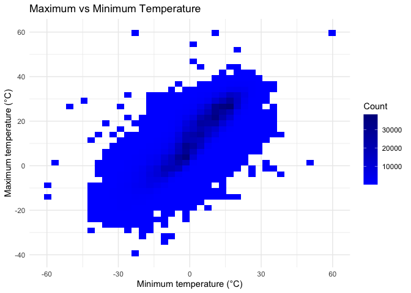
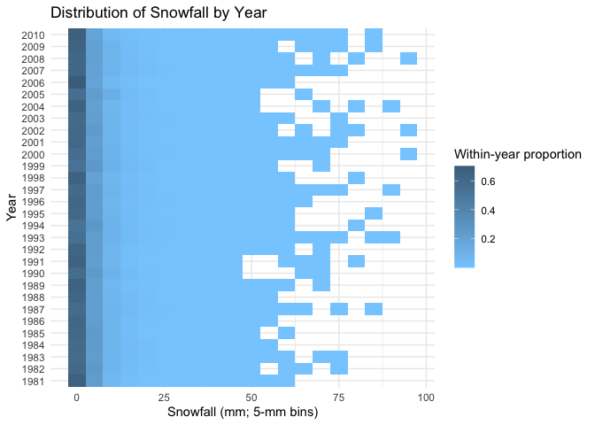

p8105_hw3_zg2627
================
Zimu Guan
2026-10-19

## Problem 1

``` r
library(tidyverse)
```

    ## ── Attaching core tidyverse packages ──────────────────────── tidyverse 2.0.0 ──
    ## ✔ dplyr     1.2.1     ✔ readr     2.2.0
    ## ✔ forcats   1.0.1     ✔ stringr   1.6.0
    ## ✔ ggplot2   4.0.3     ✔ tibble    3.3.1
    ## ✔ lubridate 1.9.5     ✔ tidyr     1.3.2
    ## ✔ purrr     1.2.2     
    ## ── Conflicts ────────────────────────────────────────── tidyverse_conflicts() ──
    ## ✖ dplyr::filter() masks stats::filter()
    ## ✖ dplyr::lag()    masks stats::lag()
    ## ℹ Use the conflicted package (<http://conflicted.r-lib.org/>) to force all conflicts to become errors

``` r
library(p8105.datasets)

data("ny_noaa")

# Check dapa shape and structure
dim(ny_noaa)
```

    ## [1] 2595176       7

``` r
glimpse(ny_noaa)
```

    ## Rows: 2,595,176
    ## Columns: 7
    ## $ id   <chr> "US1NYAB0001", "US1NYAB0001", "US1NYAB0001", "US1NYAB0001", "US1N…
    ## $ date <date> 2007-11-01, 2007-11-02, 2007-11-03, 2007-11-04, 2007-11-05, 2007…
    ## $ prcp <int> NA, NA, NA, NA, NA, NA, NA, NA, NA, NA, NA, NA, NA, NA, NA, NA, 3…
    ## $ snow <int> NA, NA, NA, NA, NA, NA, NA, NA, NA, NA, NA, NA, NA, NA, NA, NA, 3…
    ## $ snwd <int> NA, NA, NA, NA, NA, NA, NA, NA, NA, NA, NA, NA, NA, NA, NA, NA, 0…
    ## $ tmax <chr> NA, NA, NA, NA, NA, NA, NA, NA, NA, NA, NA, NA, NA, NA, NA, NA, N…
    ## $ tmin <chr> NA, NA, NA, NA, NA, NA, NA, NA, NA, NA, NA, NA, NA, NA, NA, NA, N…

``` r
# Check NA proportion of each variable
ny_noaa |>
  summarize(
    across(
      everything(),
      ~ mean(is.na(.))
    )
  ) |>
  pivot_longer(
    everything(),
    names_to = "variable",
    values_to = "proportion_missing"
  ) |>
  arrange(desc(proportion_missing))
```

    ## # A tibble: 7 × 2
    ##   variable proportion_missing
    ##   <chr>                 <dbl>
    ## 1 tmin                 0.437 
    ## 2 tmax                 0.437 
    ## 3 snwd                 0.228 
    ## 4 snow                 0.147 
    ## 5 prcp                 0.0562
    ## 6 id                   0     
    ## 7 date                 0

The `ny_noaa` dataset contains 2,595,176 observations and 7 variables.
Each row represents a daily weather observation from a NOAA weather
station in New York State. Key variables include station ID (`id`), date
(`date`), precipitation (`prcp`), snowfall (`snow`), snow depth
(`snwd`), maximum temperature (`tmax`), and minimum temperature
(`tmin`). The `date` variable is stored as a date, while `prcp`, `snow`,
and `snwd` are stored as integers; `tmax` and `tmin` are currently
stored as character variables and will require cleaning before analysis.

Missing data are a substantial issue in this dataset. Approximately
43.7% of observations are missing for both `tmin` and `tmax`, while
22.8% are missing for `snwd`, 14.7% for `snow`, and 5.6% for `prcp`. The
station ID and date variables have no missing values.

``` r
# Clean the NY NOAA data and create separate date variables
ny_noaa_clean =
  ny_noaa |>
  mutate(
    # Extract year, month, and day from the date variable
    year = lubridate::year(date),
    month = lubridate::month(date),
    day = lubridate::day(date),

    # Convert temperature variables to degrees Celsius
    tmax = as.numeric(tmax) / 10,
    tmin = as.numeric(tmin) / 10,

    # Convert precipitation, snowfall, and snow depth to millimeters
    prcp = prcp / 10,
    snow = snow / 10,
    snwd = snwd / 10
  )

# Check the structure of the cleaned dataset
glimpse(ny_noaa_clean)
```

    ## Rows: 2,595,176
    ## Columns: 10
    ## $ id    <chr> "US1NYAB0001", "US1NYAB0001", "US1NYAB0001", "US1NYAB0001", "US1…
    ## $ date  <date> 2007-11-01, 2007-11-02, 2007-11-03, 2007-11-04, 2007-11-05, 200…
    ## $ prcp  <dbl> NA, NA, NA, NA, NA, NA, NA, NA, NA, NA, NA, NA, NA, NA, NA, NA, …
    ## $ snow  <dbl> NA, NA, NA, NA, NA, NA, NA, NA, NA, NA, NA, NA, NA, NA, NA, NA, …
    ## $ snwd  <dbl> NA, NA, NA, NA, NA, NA, NA, NA, NA, NA, NA, NA, NA, NA, NA, NA, …
    ## $ tmax  <dbl> NA, NA, NA, NA, NA, NA, NA, NA, NA, NA, NA, NA, NA, NA, NA, NA, …
    ## $ tmin  <dbl> NA, NA, NA, NA, NA, NA, NA, NA, NA, NA, NA, NA, NA, NA, NA, NA, …
    ## $ year  <dbl> 2007, 2007, 2007, 2007, 2007, 2007, 2007, 2007, 2007, 2007, 2007…
    ## $ month <dbl> 11, 11, 11, 11, 11, 11, 11, 11, 11, 11, 11, 11, 11, 11, 11, 11, …
    ## $ day   <int> 1, 2, 3, 4, 5, 6, 7, 8, 9, 10, 11, 12, 13, 14, 15, 16, 17, 18, 1…

I first cleaned the dataset by separating the date into year, month, and
day variables and converting the weather measurements into more
interpretable units.

``` r
# Summarize the cleaned weather variables
ny_noaa_clean |>
  select(tmax, tmin, prcp, snow, snwd) |>
  summary()
```

    ##       tmax              tmin              prcp               snow          
    ##  Min.   :-38.90    Min.   :-59.400   Min.   :   0.000   Min.   :  -1.3000  
    ##  1st Qu.:  5.00    1st Qu.: -3.900   1st Qu.:   0.000   1st Qu.:   0.0000  
    ##  Median : 15.00    Median :  3.300   Median :   0.000   Median :   0.0000  
    ##  Mean   : 13.98    Mean   :  3.029   Mean   :   2.982   Mean   :   0.4987  
    ##  3rd Qu.: 23.30    3rd Qu.: 11.100   3rd Qu.:   2.300   3rd Qu.:   0.0000  
    ##  Max.   : 60.00    Max.   : 60.000   Max.   :2286.000   Max.   :1016.0000  
    ##  NAs    :1134358   NAs    :1134420   NAs    :145838     NAs    :381221     
    ##       snwd        
    ##  Min.   :  0.000  
    ##  1st Qu.:  0.000  
    ##  Median :  0.000  
    ##  Mean   :  3.731  
    ##  3rd Qu.:  0.000  
    ##  Max.   :919.500  
    ##  NAs    :591786

``` r
# Identify the most commonly observed snowfall values
ny_noaa_clean |>
  count(snow, sort = TRUE) |>
  slice_head(n = 10)
```

    ## # A tibble: 10 × 2
    ##     snow       n
    ##    <dbl>   <int>
    ##  1   0   2008508
    ##  2  NA    381221
    ##  3   2.5   31022
    ##  4   1.3   23095
    ##  5   5.1   18274
    ##  6   7.6   10173
    ##  7   0.8    9962
    ##  8   0.5    9748
    ##  9   3.8    9197
    ## 10   0.3    8790

The most commonly observed snowfall value is 0 mm, with 2,008,508
observations. This is expected because snowfall occurs only on a
relatively small number of days, so zero snowfall is much more common
than any positive amount. Among nonzero values, small snowfall amounts
such as 2.5 mm, 1.3 mm, and 5.1 mm are observed relatively frequently,
which is consistent with light snowfall events being more common than
heavy snowfall.

``` r
# Calculate average maximum temperature in January and July

jan_jul_temp =
  ny_noaa_clean |>
  filter(month %in% c(1, 7)) |>
  group_by(id, year, month) |>
  summarize(
    mean_tmax = mean(tmax, na.rm = TRUE),
    .groups = "drop"
  ) |>
  filter(!is.nan(mean_tmax))

# Label the month
jan_jul_temp =
  jan_jul_temp |>
  mutate(
    month = factor(
      month,
      levels = c(1, 7),
      labels = c("January", "July")
    )
  )

# Plot average maximum temperature by station across years
ggplot(
  jan_jul_temp,
  aes(x = year, y = mean_tmax, group = id)
) +
  geom_line(alpha = 0.15) +
  facet_wrap(~ month, ncol = 2) +
  labs(
    title = "Average January and July Maximum Temperatures by Station",
    x = "Year",
    y = "Average maximum temperature (°C)"
  ) +
  theme_minimal()
```

<!-- -->
Average maximum temperatures are substantially lower and more variable
in January than in July. January station-level averages are generally
centered near 0°C, while July averages are mostly in the mid-to-upper
20s °C. There is substantial year-to-year variation, especially in
January, but no strong monotonic temporal trend is immediately apparent.
A few unusually low station-year averages appear in both months and may
represent outliers or stations with unusual local conditions.

``` r
# Plot the joint distribution of maximum and minimum temperatures
temp_plot =
  ny_noaa_clean |>
  filter(
    !is.na(tmax),
    !is.na(tmin)
  ) |>
  ggplot(aes(x = tmin, y = tmax)) +
  geom_bin_2d(bins = 40) +
  scale_fill_gradient(
    low = "blue1",
    high = "blue4"
  ) +
  labs(
    title = "Maximum vs Minimum Temperature",
    x = "Minimum temperature (°C)",
    y = "Maximum temperature (°C)",
    fill = "Count"
  ) +
  theme_minimal()

temp_plot
```

<!-- -->

Maximum and minimum temperatures show a strong positive relationship,
with most observations concentrated along an upward-sloping band. Most
daily maximum temperatures are higher than the corresponding minimum
temperatures, as expected. A small number of extreme observations appear
far from the main distribution and may reflect unusual or erroneous
measurements.

``` r
# Keep positive snowfall values below 100 mm
snow_plot_data =
  ny_noaa_clean |>
  filter(
    snow > 0,
    snow < 100
  )

# Summarize snowfall distributions within each year
snow_plot_data =
  ny_noaa_clean |>
  filter(
    snow > 0,
    snow < 100
  ) |>
  mutate(
    snow_bin = floor(snow / 5) * 5
  ) |>
  count(year, snow_bin) |>
  group_by(year) |>
  mutate(
    proportion = n / sum(n)
  ) |>
  ungroup()

# Plot snowfall distributions separately by year
snow_plot =
  snow_plot_data |>
  ggplot(
    aes(
      x = snow_bin,
      y = factor(year),
      fill = proportion
    )
  ) +
  geom_tile() +
  scale_fill_gradient(
    low = "skyblue1",
    high = "skyblue4"
  ) +
  labs(
    title = "Distribution of Snowfall by Year",
    x = "Snowfall (mm; 5-mm bins)",
    y = "Year",
    fill = "Within-year proportion"
  ) +
  theme_minimal()

snow_plot
```

<!-- -->

Across years, positive snowfall amounts below 100 mm are strongly
concentrated at smaller values. Larger snowfall amounts occur much less
frequently, indicating a strongly right-skewed distribution. This
general pattern is fairly consistent across years, although some
year-to-year variation is present.

``` r
# Create two-panel plot
library(patchwork)
temp_plot / snow_plot
```

<!-- -->
